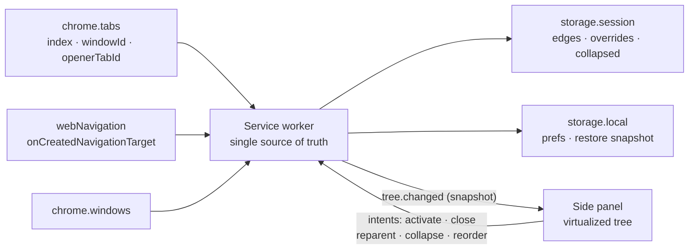

# Tab Tree

[](https://github.com/Eveosev/tab-tree/actions/workflows/ci.yml)

**Tree-style tab management for Chrome’s side panel.** Tabs you open from a link become children of the page that opened them; tabs you open independently stay top-level. No account, no network, no build step.


## Why

Chrome’s tab strip is flat. Research branches (docs → API → example → issue) turn into an unreadable row of lookalike tabs. Chrome exposes no API to restyle the native strip, but it does expose the signal that matters: **which page opened a new tab**.

- Open a link from **A** → the new tab renders indented under **A**.
- Press **Ctrl/Cmd+T**, type a URL, open a bookmark → no opener → the tab is a **root**, a sibling of A.
- A→B→C nesting is supported to any practical depth.

The relation is captured from `chrome.webNavigation.onCreatedNavigationTarget` (and `tabs.onCreated`/live `openerTabId` as fallbacks) the moment the tab is created, then persisted for the browser session. This matters because Chrome **clears `openerTabId`** as soon as another foreground tab is inserted: relying on the live property alone would flatten A→B→C after the second child opens. Captured edges are what make the tree stable.

The tree lives in the native **side panel** (Chrome 114+), next to the page you are browsing. The toolbar button opens it.

## Features

| | |
| --- | --- |
| 🌳 **Automatic tree** | Link-opened tabs nest under their opener via captured creation edges; dead relations are promoted and marked. |
| 📏 **Indentation** | Exactly 16 px per level, with vertical guide lines. |
| ↔️ **Drag to reparent** | Drop on a row to make it a child, drop on the bottom zone to make it top-level. Cycles and cross-window parents are rejected. |
| ⌨️ **Keyboard-first** | `↑/↓` move, `←` collapse/parent, `→` expand/child, `Enter` activate, `Delete` close, `/` search. |
| 🔍 **Search** | Filters title/URL, keeps ancestors visible, auto-expands matches. |
| 🧭 **Multi-window** | One forest per window; a window picker appears when more than one exists. |
| 🗂️ **Collapse / expand all** | Bulk toggle, state persisted for the browser session. |
| 💾 **Session restore** | Fingerprint snapshot + order-preserving URL matching after a browser restart; restored links carry a badge. |
| ⚡ **Fast with hundreds of tabs** | Fixed-height virtual list, 60 ms event coalescing, pure rebuild-on-demand engine. |
| 🎨 **Native feel** | Automatic light/dark, compact rows, favicons, pinned/audio indicators. |
| 🌍 **i18n** | English and Simplified Chinese (`_locales`). |
| 🔒 **Local-only** | No host permissions, no content scripts, no telemetry, no remote code. |

## Install (unpacked, Chrome 114+)

1. Clone this repo.
2. Open `chrome://extensions`, enable **Developer mode**.
3. **Load unpacked** → select the `extension/` directory.
4. Click the Tab Tree toolbar icon (or the side-panel button) to open the panel.

A packaged build is also available: `npm run build` creates `dist/tab-tree-v0.1.2.zip`.

> Chrome 137+ ignores `--load-extension` on branded builds; use Chrome for Testing/Chromium for automated runs (see *Development*).

## Usage

- **Tree** – rows with a twisty have children. Click the twisty (or `←`/`→`) to collapse/expand.
- **Open** – click a row or press `Enter`; middle-click or `Delete` closes the tab.
- **Rearrange** – drag a row onto another row to nest it; drag to the floating “make top-level” zone to un-nest it. Reparenting is an explicit override and survives worker restarts; it is released when the tab closes.
- **Filter** – type in the search box; ancestors of matches remain visible. `Esc` clears.
- **Sort the native strip** – the toolbar sort button (or automatic after a drag, configurable) reorders Chrome’s tab strip into tree (DFS) order. Pinned tabs stay pinned at the front.
- **Settings** – choose whether closing a parent also closes its children (off by default: children are promoted one level), and whether drag-reparent should auto-sort the native strip.

### Keyboard map

| Key | Action |
| --- | --- |
| `↑` / `↓` | Move selection |
| `Home` / `End` | First / last visible tab |
| `→` | Expand collapsed node, otherwise move to first child |
| `←` | Collapse expanded node, otherwise move to parent |
| `Enter` / `Space` | Activate selected tab |
| `Delete` / `Backspace` | Close selected tab |
| `/` | Focus search |
| `Esc` | Clear search / close popover |
| Right-click | Context menu (activate, collapse, make top-level, close, close subtree) |
| Middle-click | Close tab |

## How it works



- **Parent inference:** explicit override → captured creation edge → live `openerTabId` → root. A dead opener is marked `orphan`; an override chain that would cycle is broken defensively. Closing a parent promotes its direct children one level (A > B > C becomes A > C); “close children with parent” is available in Settings.
- **Rebuild on wake:** MV3 workers are disposable. Every wake re-queries tabs and recomputes the forest, so no event can be permanently lost.
- **Restore:** a compact `{url, index, parentId}` snapshot is written to `storage.local`; a marker in `storage.session` distinguishes a real browser restart from a service-worker wake (a live-opener guard additionally avoids overwriting an extension reload with intact relations). After a restart, windows are paired by URL overlap and tabs are aligned with LCS over normalized URLs, then parent links are transferred. Uncertain links are marked and can be re-hung by dragging.
- **Ordering:** siblings follow `tab.index`; DFS flattening defines native order after an explicit sort.

More detail: [design](docs/design.md) · [中文设计说明](docs/design.zh.md) · [research notes](docs/research.md) · [verification report](docs/verification.md).

## Permissions

| Permission | Purpose |
| --- | --- |
| `tabs` | Read tab metadata (`openerTabId`, title, URL, favicon), activate/close/move tabs on user action. |
| `sidePanel` | Host the tree in Chrome’s side panel. |
| `storage` | Persist preferences, creation edges, collapse state and the restore snapshot locally. |
| `webNavigation` | Receive `onCreatedNavigationTarget` so a link-opened tab is remembered as a child **before Chrome clears `openerTabId`**. No host permissions are added and no page content is read. |

Chrome shows the normal “Read your browsing history” warning for the `tabs`/`webNavigation` capabilities. No `<all_urls>`, no content scripts, no telemetry, no remote code. Everything stays on your machine (favicons are fetched by Chrome, not by the extension).

## Development

Requirements: Node.js ≥ 20, Chrome/Chromium 114+, `zip`/`unzip` for packaging.

```bash
npm test           # 35 engine unit tests (node:test, zero dependencies)
npm run check      # syntax, JSON, manifest refs, i18n parity, permission guard
npm run build      # dist/tab-tree-v0.1.2.zip (+ sha256)
npm run smoke      # real Chrome via CDP: nesting, panel DOM, collapse, close, worker restart, screenshots
npm run test:e2e   # acceptance gate: real mouse clicks A→B, A→C, B→D on a live Chrome
npm run test:panel # real pointer drag (nest / un-nest / cycle) + per-window panel binding
npm run test:restart # closes and restarts Chrome on the same profile, asserts the tree comes back
npm run bench      # 300-tab benchmark; TABS=500 npm run bench for the 500-tab run
npm run verify     # check + test + build
npm run verify:all # check + test + build + all three browser suites
```

Latest evidence (macOS arm64, Chrome for Testing 156): `test:e2e` 8/8,
`test:panel` 11/11, `test:restart` 10/10, `bench` 8/8. On 300 tabs a full
service-worker rebuild measured 8.5 ms at p95 (500 tabs: 19.9 ms), the virtual
list keeps <80 rows in the DOM, and scroll/search stay at about one frame. See [verification](docs/verification.md).

No `npm install` is needed — the extension has **zero runtime and build dependencies**. Everything in `extension/` is plain ES modules loaded directly by Chrome.

### Smoke test note

Branded Chrome 137+ ignores `--load-extension` (a malware mitigation). `npm run smoke` automatically prefers a Playwright-cached **Chrome for Testing** or a Chromium binary; set `CHROME_PATH` to point at one explicitly. The smoke test drives a real browser, creates real link-opened tabs, inspects the generated tree, exercises the side-panel DOM, kills the service worker, and captures the screenshots in `docs/`.

### Project layout

```
extension/
  manifest.json            MV3 manifest (114+, tabs/sidePanel/storage/webNavigation)
  background.js            service worker: events, build loop, intents, persistence
  sidepanel.html/.css/.js  virtualized tree UI
  lib/tree-engine.js       pure tree algorithms (tested in Node)
  _locales/{en,zh_CN}       UI strings
  icons/                   16/32/48/128 PNGs
test/tree-engine.test.js   engine unit tests
scripts/
  check.mjs                static checks
  build.mjs                store-shaped zip + sha256
  smoke.mjs                browser smoke suite
  e2e-real-links.mjs       real-mouse link acceptance gate
  e2e-panel.mjs            pointer drag + per-window panel binding
  e2e-restart.mjs          real browser restart restore
  bench-tabs.mjs           300/500-tab performance benchmark
  lib/harness.mjs          shared dependency-free CDP harness
docs/research.md           product research, competitors, ADRs
docs/design.md             architecture, algorithms, protocol, risks
```

## Known limitations

- Chrome provides no way to restyle the native tab strip, so the tree is a side panel, not a replacement strip. Chrome also decides whether the side panel sits on the left or right (`chrome://settings/appearance` → side panel position); an extension cannot force it to the left.
- Creation edges are session-scoped, like Chrome’s own tab ids. After a browser restart the tree is reconstructed by the heuristic matcher and marked as inferred.
- Tabs that were already open before the extension was installed have no captured edge and start as roots until you drag them.
- Session restore is heuristic: duplicate URLs and heavy reordering can produce an occasional wrong link. Chrome restores tabs asynchronously, so the worker retries the URL/LCS match for up to 15 s after startup. Restored links are badged and can be fixed in one drag.
- Collapse state is session-scoped (tab ids do not survive a browser restart).
- Drag currently changes parent/child, not sibling order.
- Side panel requires Chrome 114+; a popup fallback is on the roadmap.

## Roadmap

- v0.2: sibling drag reorder, undo close, popup fallback for Chrome < 114, group filters.
- v0.3: saved workspaces/snapshots, JSON export/import, cross-window search, fuzzy matching.

## License

MIT © Eveosev
