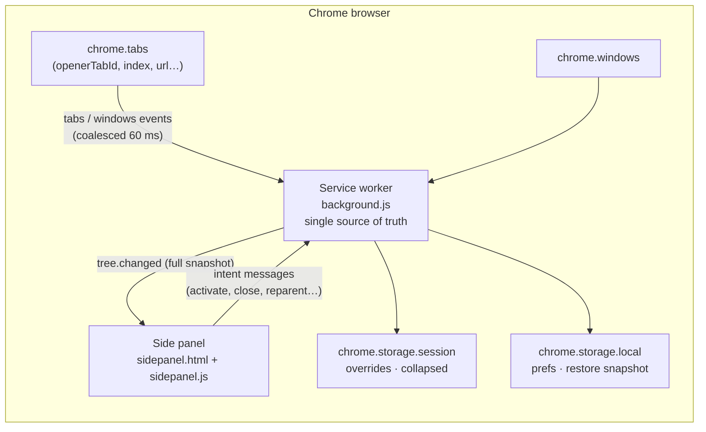

# Tab Tree — technical design

Version: 0.1.0 · Chrome 114+ · MV3 · zero-build ES modules

## 1. Goals and non-goals

**Goals**

1. Link-opened tabs automatically appear **one indentation level below** the tab that opened them; independently opened tabs are **roots (siblings)**.
2. The tree must survive MV3 service-worker termination and, best-effort, browser restart.
3. Interactions stay fast with hundreds of tabs: virtualized rendering, coalesced events, pure engine.
4. Minimal permissions and a fully local data path.

**Non-goals (v0.1.0):** restyling Chrome’s native tab strip (impossible), cloud sync, collaborative workspaces, editing tab groups, Firefox port, mobile.

## 2. Architecture



- **Service worker** owns the forest. It never trusts the panel with state.
- **Panel** is a pure view: it renders snapshots, sends intents, and keeps only ephemeral UI state (search, selection, scroll, drag).
- A long-lived `chrome.runtime.connect` port carries snapshots down and intents up. A panel connection also **wakes** a sleeping worker, which rebuilds from `chrome.tabs`.

### Module layout

| Path | Responsibility |
| --- | --- |
| `extension/lib/tree-engine.js` | Pure functions: parent inference, DFS/depth, cycle guard, collapse visibility, search, native ordering, restore matching. No `chrome.*`. |
| `extension/background.js` | Event wiring, build loop, persistence, intents, port broadcast, native reorder. |
| `extension/sidepanel.js` | Virtualized tree, drag/keyboard/search, context menu, settings, demo mode. |
| `extension/sidepanel.css` | Light/dark design tokens, rows, guides, popovers, drag affordances. |
| `extension/_locales/{en,zh_CN}` | All UI strings (37 keys each). |
| `test/tree-engine.test.js` | 29 `node:test` cases covering engine branches. |
| `scripts/check.mjs` | Syntax, JSON, manifest references, i18n usage/parity, permission guard. |
| `scripts/build.mjs` | Store-shaped zip + sha256. |
| `scripts/smoke.mjs` | Real Chrome via CDP: opener nesting, panel DOM, collapse, close, worker restart, screenshots. |

## 3. Data model

```ts
type Node = {
  tabId: number;
  windowId: number;
  parentId: number | null;
  childIds: number[];
  depth: number;           // 0 = root
  order: number;           // DFS index inside the window
  index: number;           // native tab.index
  title: string;
  url: string;
  domain: string;
  favIconUrl: string;
  active: boolean;
  pinned: boolean;
  audible: boolean;
  muted: boolean;
  discarded: boolean;
  hasChildren: boolean;
  descendantCount: number;
  collapsed: boolean;
  openerTabId: number | null;
  orphan: boolean;         // opener no longer exists
  inferred: boolean;       // parent came from session restore
  groupId: number;         // read-only
};

type Snapshot = {
  version: 1;
  revision: string;        // FNV-1a over structural fields
  updatedAt: number;
  focusedWindowId: number | null;
  activeTabId: number | null;
  prefs: Prefs;
  windows: Array<{ id; focused; tabCount; activeTabId; rootIds; collapsedCount }>;
  nodes: Node[];           // DFS order, per window
  restore: null | { appliedAt: number; stats: RestoreStats };
};
```

`Snapshot` is the only wire format. It is small (≈150 bytes/tab) and idempotent; the panel can miss intermediate patches without diverging.

## 4. Parent inference

Priority per tab:

1. **Explicit override** (`overrides: Map<tabId, parentId | null>`): set by drag-reparent, “make top-level”, or session restore. Applied only if the parent is alive, in the same window, and not the tab itself.
2. **`tab.openerTabId`** if the opener is alive in the same window.
3. **Root**: no opener, opener closed, or opener in another window. If an opener id exists but the tab is gone, mark `orphan`.

```
resolve(tab):
  if overrides.has(tab.id):
     p = overrides.get(tab.id)
     if p == null: return ROOT
     if alive(p) && sameWindow(p, tab) && p != tab.id: return p
     // dead/foreign override → fall through
  if tab.openerTabId is integer:
     if alive(opener) && sameWindow(opener, tab): return opener
     return ROOT(orphan)
  return ROOT
```

After resolution:

- **Cycle guard:** walk the parent chain for every node; if a cycle or a chain longer than `MAX_DEPTH = 64` is found, the node becomes a root (`cycle-broken`). This protects the worker from stale/corrupt overrides.
- **DFS:** children sorted by `tab.index`, roots sorted by `tab.index`; iterative stack (no recursion limit) assigns `depth`/`order`, and descendant counts are accumulated bottom-up.
- **Reachability:** any node not reached from a root is appended as a root so no tab is ever silently dropped.

**Why this matches the product definition**

| User action | Chrome signal | Result |
| --- | --- | --- |
| Link / Ctrl-click / middle-click / `window.open` from A | new tab has `openerTabId = A` | child of A, depth +1 |
| `Ctrl/Cmd+T`, address bar, bookmark, “open in new tab” from the tab strip | no opener | root, sibling of A |
| Parent A closes | Chrome may reset opener / opener id dies | child promoted to root (data preserved) |
| User drags B onto C | override `B → C` | B becomes C’s child, locked until B closes |

## 5. Collapse and visibility

- Collapse state is a `Set<tabId>` in the worker, persisted to `storage.session`; it survives worker restart but not browser restart.
- `buildSnapshot` marks `node.collapsed` only when the node has children.
- The panel calls `getVisibleNodes(snapshot, windowId, { query })`:
  - DFS from `rootIds`; stop at collapsed nodes;
  - if a query is active, compute matches and their ancestor paths, then render only that subtree(s) **expanded**, so a match deep under a collapsed parent is still reachable;
  - `depth` is recomputed to reflect the rendered tree.
- Header toggle: “collapse all” sets every node with children; “expand all” clears the set.

## 6. Session restore

The only genuinely hard part. `tabId` is not stable across browser restarts, and Chrome does not preserve `openerTabId` when restoring a session.

### 6.1 Snapshot

`chrome.storage.local.restoreSnapshot`:

```json
{
  "version": 1,
  "savedAt": 1730000000000,
  "focusedWindowId": 3,
  "windows": [{ "id": 3, "rootIds": [12, 19] }],
  "nodes": [
    { "tabId": 12, "parentId": null, "windowId": 3, "index": 0, "pinned": false, "title": "…", "url": "…" }
  ]
}
```

Written 900 ms after a change (debounced) and on `onSuspend`.

### 6.2 Matching

```
applicable = no live tab has openerTabId
          && now - savedAt > 15 s
          && no session overrides
```

- The 15 s window avoids fighting live state right after a worker wake.
- If Chrome *did* preserve openers, they are strictly better than fingerprints.
- Window pairing: greedy max URL-overlap between saved windows and live windows (a window can be reused after restart, so ids are not trustworthy).
- Tab pairing inside a pair: **longest common subsequence** over `normalizedUrl + pinned` ordered by native index. LCS tolerates tabs closed and reordered while preserving order.
- Transfer a parent link only if both endpoints matched; otherwise the tab becomes a root with `inferred`/`lost` semantics. Every restored node is flagged `inferred` and rendered with a restore badge.
- Stats (`matchedTabs / oldNodes / relations / windows`) are broadcast and shown in the panel footer.

### 6.3 Known limits

- Two tabs with identical URLs in the same window and unusual reordering can cross-pair; LCS keeps this deterministic but not omniscient.
- Tabs opened in a window that was closed while Chrome was off cannot be restored.
- Collapse state is intentionally session-scoped, so it resets on browser restart.

## 7. Ordering and native tab strip

- Sibling order = `tab.index`. The panel never invents a separate order, avoiding a second source of truth.
- **Drag = reparent only**, not sibling reorder. After a reparent, if `prefs.autoSortNative` is on, the worker calls `reorderNative(windowId)`:
  - pinned tabs stay first (Chrome enforces this);
  - unpinned tabs are placed sequentially at `pinnedCount + i` in DFS order;
  - a 1.5 s `reorderUntil` guard suppresses re-entrant reorder loops from `tabs.onMoved`.
- `tabs.move` events still trigger a rebuild, which is harmless because the tree derives from indices and overrides.

## 8. Service-worker protocol

Port name: `tab-tree`.

**Worker → panel**

| Message | Payload | When |
| --- | --- | --- |
| `tree.changed` | full `Snapshot` | initial connect, any structural change (debounced 60 ms), collapse/prefs changes |
| `action.result` | `{ requestId, ...result }` | intent succeeded |
| `action.error` | `{ requestId, error }` | intent failed (validation, tab gone, timeout) |

**Panel → worker**

| Message | Payload | Semantics |
| --- | --- | --- |
| `tree.getSnapshot` | — | wake/re-sync |
| `tab.activate` | `tabId` | activate tab and focus its window |
| `tab.close` | `tabId`, `subtree` | close one tab, or tab + descendants |
| `node.setCollapsed` | `tabId`, `collapsed` | persist and broadcast |
| `tree.setAllCollapsed` | `collapsed` | bulk collapse/expand |
| `node.reparent` | `tabId`, `parentTabId \| null` | validate via `canReparent`, persist override, optionally reorder |
| `tree.reorderNative` | `windowId?` | flatten native strip in tree order |
| `prefs.set` | partial prefs | persist to local, rebuild |
| `window.focus` | `windowId` | focus another browser window |
| `tree.rebuild` | — | manual refresh |

Every intent is validated in the worker; the panel cannot inject an arbitrary parent (cycles, cross-window edges, self-parenting rejected). All actions carry a `requestId` so the panel can show errors.

## 9. Persistence and lifecycle

| Key | Area | Contents | Lifetime |
| --- | --- | --- | --- |
| `prefs` | local | `closeChildrenWithParent`, `autoSortNative` | permanent |
| `restoreSnapshot` | local | compact tree fingerprint | overwritten, debounced |
| `restoreStats` | local | last restore stats | diagnostic |
| `overrides` | session | `[tabId, parentId \| null][]` | browser session / worker restarts |
| `collapsed` | session | `tabId[]` | browser session / worker restarts |

Wake path: module loads → `init()` loads storage → queries tabs/windows → prunes dead overrides → maybe restores → `buildNow()` → port clients get a snapshot. Event listeners are registered synchronously, so no early events are lost.

Change detection uses `revision`; unchanged rebuilds do not broadcast or persist.

## 10. UI specification

```
┌────────────────────────────────────────┐
│ 🌳 Tab Tree        [Window 1 · 7] ⚙    │  36 px brand row
│ 🔍 Search tabs…                    7/9 │  30 px search row
├────────────────────────────────────────┤
│ ▸ chrome.sidePanel API — Chrome …      │  active row, root
│     Design a side panel experience     │  depth 1
│        SidePanelOptions reference      │  depth 2
│     chrome.tabs API — openerTabId      │  depth 1 (active)
│ ▾ Tree Style Tab — Firefox Add-ons     │  collapsed root (count 2)
│   Arc — Tabs, spaces and profiles      │  root
├────────────────────────────────────────┤
│ 9 tabs · 4 top-level      6 links rest.│  26 px status
└────────────────────────────────────────┘
```

- **Indentation:** exactly `depth × 16 px`; vertical guide lines are drawn with a repeating gradient on the indent span. `data-depth`, `data-parent-id`, `role=treeitem`, `aria-level`, `aria-expanded`, `aria-selected` are set for tests/accessibility.
- **Row:** twisty (only when children), 16 px favicon with letter fallback, ellipsized title, badges (pinned/audio/restored/orphan/collapsed count), close button on hover. Fixed 32 px height for virtualization.
- **Active tab** gets an accent tint and semibold title; the selected row gets an outline. Keyboard focus is visible.
- **Search:** filters on title+URL case-insensitively; ancestors stay visible; matched subtrees auto-expand. `Esc` clears, `Enter` activates the first match.
- **Keyboard:** `↑/↓` move, `Home/End`, `←` collapse-or-parent, `→` expand-or-first-child, `Enter/Space` activate, `Delete/Backspace` close, `/` focus search.
- **Context menu:** Activate · Collapse/Expand children · Make top-level · Close · Close tab and children.
- **Drag:** pointer events; 6 px threshold; ghost label; row highlight; auto-scroll near edges; drop on a row = child, drop on the fixed root zone = top-level; `Esc` is not required because releasing outside cancels. A click after a drag is suppressed for 300 ms.
- **Virtualization:** `tree-inner` height = `rows × 32`; absolute rows; only visible rows + 8 overscan are in the DOM; re-render is skipped when the range/revision is unchanged.
- **Theme:** `prefers-color-scheme`; both themes verified in screenshots.
- **i18n:** manifest + 37 UI keys, EN and zh_CN, with English fallback for demo mode.

## 11. Robustness

| Scenario | Behaviour |
| --- | --- |
| Worker killed | Panel port disconnects → reconnect loop (450 ms). Connect wakes worker; `init()` rebuilds from tabs; panel gets `tree.changed`. |
| Rapid tab storm (open 50 links) | `scheduleBuild` debounce 60 ms; `building` flag + `buildAgain` coalescing; one broadcast per settled state. |
| Tab replaced (prerender) | `tabs.onReplaced` migrates overrides/collapse to the new id. |
| Parent closed | Overrides pointing at it are pruned; children fall back to opener (likely dead) → promoted roots with orphan/inferred marker. |
| Duplicate/reordered session tabs | LCS alignment remains deterministic; low-confidence links can be fixed by drag. |
| Corrupt override cycle | Cycle guard roots the offending node; every tab stays visible. |
| Panel opened in a normal tab (dev) | Same document works; it shows up as a tab in its own tree. |
| `sidePanel` unavailable (<114) | Manifest prevents install; a popup fallback is a roadmap item, not silently broken. |

## 12. Security & privacy

- No host permissions, no content scripts, no remote code, no `eval`, no network calls.
- URLs/titles are processed in memory and stored locally only; nothing leaves the browser.
- All rendered text uses `textContent`; only constant SVG strings use `innerHTML`.
- Intents are validated server-side (cycle/cross-window checks); the panel cannot close arbitrary ids outside the snapshot? It can send any tabId, and `tabs.remove` would apply — same as any `tabs`-permission extension. The panel is extension-origin only.
- Extension pages use the default MV3 CSP (`script-src 'self'`); the only inline handlers are none.

## 13. Testing strategy

| Layer | Tool | Coverage |
| --- | --- | --- |
| Engine | `node --test` | 29 cases: inference, orphan, cross-window, overrides, cycles, DFS ordering, descendant count, collapse/search, reparent validation, native order, restore (dead tab, sealed windows, duplicates, fresh/openers), serialization, pruning, hash, depth cap, prefs |
| Static | `scripts/check.mjs` | every `.js` parses, JSON valid, manifest files exist, i18n key parity and usage, version consistency, no `<all_urls>` |
| Build | `scripts/build.mjs` | zip `dist/tab-tree-v0.1.0.zip`, print sha256/size |
| E2E | `scripts/smoke.mjs` | real Chrome for Testing: load extension, real link clicks create real `openerTabId` chains, DOM indentation, collapse/expand, close, worker termination recovery, light/dark screenshots |
| Manual | chrome://extensions | load unpacked, open side panel, drag, keyboard, multi-window |

**Why Chrome for Testing:** branded Chrome 137+ ignores `--load-extension` (malware mitigation), so automated e2e uses Chrome for Testing / Chromium (`CHROME_PATH` override supported).

## 14. Acceptance criteria → evidence

| AC | Implementation | Evidence |
| --- | --- | --- |
| Link-opened tab is one level deep, `data-parent-id` = A | `openerTabId`, `buildSnapshot`, `createRow` | unit tests; smoke asserts depth/parent ids + DOM |
| Address-bar tab is a root sibling | no opener → root | unit tests; smoke `/other` |
| 3-level nesting, collapse persists | DFS + collapsed set | unit tests; smoke collapse/expand |
| Parent close promotes children / optional subtree close | `closeTab`, `getDescendantIds` | unit tests |
| Drag reparent + native DFS order | pointer drag, `canReparent`, `reorderNative` | engine tests; manual (headless drag not simulated) |
| Worker death → recover <5 s | port reconnect + rebuild | smoke kills worker, waits for revival |
| Browser restart restore ≥90% | LCS + window pairing | unit tests; manual checklist |
| Multi-window forests | windowId partitioning | unit tests |
| 500 tabs performance | virtualization + coalescing | design; manual target (<300 ms first paint) |
| No `<all_urls>`/remote code; loadable | manifest check | `npm run check`, `npm run build`, smoke load |

## 15. Risks and mitigations

| Risk | Impact | Mitigation |
| --- | --- | --- |
| `openerTabId` missing for some sources | wrong nesting | manual drag override; orphan marker; document limitations |
| Restore mismatch with duplicate URLs | wrong links after restart | LCS order matching + inferred badge + manual reparent |
| Native tab strip can’t become a tree | expectation gap | README + UI clearly frame the panel; “sort strip by tree” helps |
| Service worker termination | stale UI | reconnect loop; idempotent rebuild; session persistence |
| Large windows | jank | 32 px fixed rows, virtualization, 60 ms coalescing, no per-row listeners |
| Chrome <114 | no side panel | `minimum_chrome_version`; popup fallback planned |
| Drag UX in narrow panel | accidental reparents | 6 px threshold, clear highlight, root zone, click suppression |
| Permission warning | install friction | minimal permissions, privacy section, no network |

## 16. Roadmap

- v0.2: sibling reordering by drag, undo for close, popup fallback for <114, tab-group filters.
- v0.3: named workspaces/snapshots, export/import JSON, search across windows, fuzzy matching.
- Later: optional `webNavigation`/`referrer` fallback behind an optional permission, Firefox adapter.

## 17. Performance notes

- Build cost: O(n log n) per rebuild (sort + DFS), trivial for 500 tabs; the engine is pure and allocation-light.
- Panel: at most ~25 rows in the DOM at 380×760; scroll renders only when the row range changes.
- Broadcast: full snapshot ≈75 KB for 500 tabs; coalesced at 60 ms. A delta protocol is unnecessary at this scale and would add reconciliation bugs.
- Storage: restore snapshot ≈60 KB for 500 tabs, debounced 900 ms; well under `storage.local` quota (10 MB, unlimitedStorage not required).
