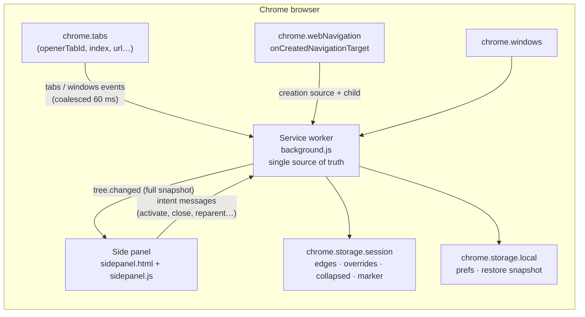

# Tab Tree — technical design

Version: 0.2.0 · Chrome 114+ · MV3 · zero-build ES modules

## 1. Goals and non-goals

**Goals**

1. Link-opened tabs automatically appear **one indentation level below** the tab that opened them; independently opened tabs are **roots (siblings)**.
2. The tree must survive MV3 service-worker termination and, best-effort, browser restart.
3. Interactions stay fast with hundreds of tabs: virtualized rendering, coalesced events, pure engine.
4. Minimal permissions and a fully local data path.

**Non-goals (v0.1.0):** restyling Chrome’s native tab strip (impossible), cloud sync, collaborative workspaces, editing tab groups, Firefox port, mobile.

## 2. Architecture



- **Service worker** owns the forest. It never trusts the panel with state.
- **Panel** is a pure view: it renders snapshots, sends intents, and keeps only ephemeral UI state (search, selection, scroll, drag).
- A long-lived `chrome.runtime.connect` port carries snapshots down and intents up. A panel connection also **wakes** a sleeping worker, which rebuilds from `chrome.tabs`.

### Module layout

| Path | Responsibility |
| --- | --- |
| `extension/lib/tree-engine.js` | Pure functions: parent inference, DFS/depth, cycle guard, collapse visibility, search, native ordering, restore matching. No `chrome.*`. |
| `extension/background.js` | Event wiring, build loop, persistence, intents, port broadcast, native reorder. |
| `extension/sidepanel.js` | Virtualized tree, drag/keyboard/search, context menu, settings, demo mode. |
| `extension/sidepanel.css` | Light/dark design tokens, rows, guides, popovers, drag affordances. |
| `extension/_locales/{en,zh_CN}` | All UI strings (37 keys each). |
| `test/tree-engine.test.js` | 35 `node:test` cases covering engine branches. |
| `scripts/check.mjs` | Syntax, JSON, manifest references, i18n usage/parity, permission guard. |
| `scripts/build.mjs` | Store-shaped zip + sha256. |
| `scripts/smoke.mjs` | Real Chrome via CDP: creation-edge nesting, panel DOM, collapse, close, worker restart, screenshots. |
| `scripts/e2e-real-links.mjs` | Acceptance gate with real mouse clicks: A→B, A→C, B→D, background click, opener-less root. |
| `scripts/e2e-panel.mjs` | Real pointer drag (nest, un-nest, cycle rejection) and per-window panel binding. |
| `scripts/e2e-restart.mjs` | Full browser restart on the same profile with `--restore-last-session`; asserts the snapshot rebuilds A→B→C. |
| `scripts/bench-tabs.mjs` | 300/500-tab rebuild, scroll and search measurements with regression ceilings. |
| `scripts/lib/harness.mjs` | Shared CDP/browser/fixture harness (no dependencies). |

## 3. Data model

```ts
type Node = {
  tabId: number;
  windowId: number;
  parentId: number | null;
  childIds: number[];
  depth: number;           // 0 = root
  order: number;           // DFS index inside the window
  index: number;           // native tab.index
  title: string;
  url: string;
  domain: string;
  favIconUrl: string;
  active: boolean;
  pinned: boolean;
  audible: boolean;
  muted: boolean;
  discarded: boolean;
  hasChildren: boolean;
  descendantCount: number;
  collapsed: boolean;
  openerTabId: number | null;
  relation: 'manual' | 'restore' | 'edge' | 'opener' | 'orphan' | 'cycle-broken' | 'root';
  orphan: boolean;         // opener no longer exists
  inferred: boolean;       // parent came from session restore
  groupId: number;         // read-only
};

type Snapshot = {
  version: 1;
  revision: string;        // FNV-1a over structure, text content and tab flags
  updatedAt: number;
  focusedWindowId: number | null;
  activeTabId: number | null;
  prefs: Prefs;
  windows: Array<{ id; focused; tabCount; activeTabId; rootIds; collapsedCount }>;
  nodes: Node[];           // DFS order, per window
  restore: null | { appliedAt: number; stats: RestoreStats };
};
```

`Snapshot` is the only wire format. It is small (≈150 bytes/tab) and idempotent; the panel can miss intermediate patches without diverging.

## 4. Parent inference

Priority per tab:

1. **Explicit override** (`overrides: Map<tabId, parentId | null>`): set by drag-reparent, “make top-level”, or session restore. Applied only if the parent is alive, in the same window, and not the tab itself.
2. **Captured creation edge** (`edges: Map<childTabId, parentTabId>`): written at creation time from `webNavigation.onCreatedNavigationTarget`, `tabs.onCreated` (`openerTabId` if present), or the first rebuild that observes a live `openerTabId`. Applied only if both tabs are alive in the same window.
3. **`tab.openerTabId`** if the opener is alive in the same window (covers background tabs / `window.open` when the edge was not captured).
4. **Root**: no opener, opener closed, or opener in another window. If an opener id exists but the tab is gone, mark `orphan`.

Why the edge map is required (v0.1.0 bug): Chromium’s `TabStripModel` calls `ForgetAllOpeners()` when a link tab is inserted in the foreground, so `openerTabId` is **transient**. A→B then A→C leaves B with `openerTabId = null`; a debounced rebuild would flatten the tree. The edge is captured synchronously and persisted to `storage.session`, so it survives both the browser clearing the property and MV3 worker termination.

```
resolve(tab):
  if overrides.has(tab.id):
     p = overrides.get(tab.id)
     if p == null: return ROOT
     if alive(p) && sameWindow(p, tab) && p != tab.id: return p
     // dead/foreign override → fall through
  edge = edges.get(tab.id)
  if edge is integer && alive(edge) && sameWindow(edge, tab): return edge
  if tab.openerTabId is integer:
     if alive(opener) && sameWindow(opener, tab): return opener
     return ROOT(orphan)
  return ROOT
```

After resolution:

- **Cycle guard:** walk the parent chain for every node; if a cycle or a chain longer than `MAX_DEPTH = 64` is found, the node becomes a root (`cycle-broken`). This protects the worker from stale/corrupt overrides.
- **DFS:** children sorted by `tab.index`, roots sorted by `tab.index`; iterative stack (no recursion limit) assigns `depth`/`order`, and descendant counts are accumulated bottom-up.
- **Reachability:** any node not reached from a root is appended as a root so no tab is ever silently dropped.

**Why this matches the product definition**

| User action | Signal captured | Result |
| --- | --- | --- |
| Link / Ctrl-click / middle-click / `window.open` from A | `onCreatedNavigationTarget` (child, source) | child of A, depth +1, survives later `ForgetAllOpeners()` |
| `chrome.tabs.create({openerTabId})` or a live opener at rebuild time | `tabs.onCreated` / build-time probe | child of A, persisted before Chrome wipes it |
| `Ctrl/Cmd+T`, address bar, bookmark, “open in new tab” from the tab strip | no edge / no opener | root, sibling of A |
| Parent A closes | `tabs.onRemoved` computes the pre-close snapshot | direct children promoted one level (A > B > C ⇒ A > C) |
| User drags B onto C | override `B → C` (beats any captured edge) | B becomes C’s child until the override is cleared |
| Tab replaced (prerender) | `tabs.onReplaced` | edges and overrides pointing at either side are migrated |

Closing the whole subtree (`closeTab(..., {subtree:true})` or the `closeChildrenWithParent` preference) marks the ids before `chrome.tabs.remove`, so `tabs.onRemoved` does not promote children of a parent that is itself going away.

## 5. Collapse and visibility

- Collapse state is a `Set<tabId>` in the worker, persisted to `storage.session`; it survives worker restart but not browser restart.
- `buildSnapshot` marks `node.collapsed` only when the node has children.
- The panel calls `getVisibleNodes(snapshot, windowId, { query })`:
  - DFS from `rootIds`; stop at collapsed nodes;
  - if a query is active, compute matches and their ancestor paths, then render only that subtree(s) **expanded**, so a match deep under a collapsed parent is still reachable;
  - `depth` is recomputed to reflect the rendered tree.
- Header toggle: “collapse all” sets every node with children; “expand all” clears the set.

## 6. Session restore

The only genuinely hard part. `tabId` is not stable across browser restarts, and Chrome does not preserve `openerTabId` when restoring a session.

### 6.1 Snapshot

`chrome.storage.local.restoreSnapshot`:

```json
{
  "version": 1,
  "savedAt": 1730000000000,
  "focusedWindowId": 3,
  "windows": [{ "id": 3, "rootIds": [12, 19] }],
  "nodes": [
    { "tabId": 12, "parentId": null, "windowId": 3, "index": 0, "pinned": false, "title": "…", "url": "…" }
  ]
}
```

Written 900 ms after a change (debounced) and on `onSuspend`.

### 6.2 Matching

```
applicable = session marker absent (= browser restart or an onStartup wake)
          && saved snapshot exists
```

`chrome.storage.session` is wiped when the browser restarts but survives MV3
worker restarts. `init()` writes a `sessionMarker` the first time it runs in a
session and only treats a missing marker (or `runtime.onStartup`) as a restart.
A plain worker wake therefore never overwrites the live tree with an old
snapshot.

v0.1.3 fixes the session-state contract. `sessionMarker` was not actually part
of the `storage.session` read set, so every plain worker wake looked like a
browser restart and replayed the snapshot; `inferred` (restored-relation) flags
were not persisted at all, so a correct marker read would have dropped the
restore badges. Marker, overrides, edges, collapse state and inferred flags are
now read/written together through `lib/session-state.js` (covered by unit
tests). `restoreStats` is cleared when a new browser session starts, so a worker
wake can never show the previous session’s “N links restored”.

v0.1.2 removed the old “no live `openerTabId` anywhere” guard. Real restarts can
leave one incidental opener (Chrome sometimes restores an extra `about:blank`
tab with an opener), which suppressed the whole restore. The retry loop is a
better guard:

1. `init()` matches immediately and applies the best partial result.
2. `tabs.onCreated/onUpdated/onRemoved/onReplaced` and focus/attach events
   re-run the match after a 250 ms debounce, replacing the previously applied
   relations with the improved alignment.
3. The loop closes when every saved tab is matched (immediately), after 8 s
   without a better match (settled), or after a hard 60 s window; the best match
   is persisted to `restoreStats` and broadcast. The 15 s window in 0.1.3 was
   too short for large/lazy sessions and produced a flat tree that needed a
   manual refresh. While the loop is active the partial rebuild is **not**
   written to `storage.local`, so the only complete snapshot cannot be
   overwritten. The pending record is persisted in `storage.session`: if the
   MV3 worker is reclaimed mid-restore, the next wake resumes the reconciliation
   instead of treating the wake as a normal session. Manual drags replace
   inferred relations even during the window.

This is required because Chrome restores session tabs asynchronously: the
service worker can start before the tabs exist, and a single one-shot match at
`init()` would see an empty window.

- Restore applies the previous tree as `overrides` (marked `restored`), which
  take priority over any new creation edges captured after startup.
- Tabs the matcher could not place keep their live opener/edge or fall back to
  a root; the retry loop only adds relations for matched endpoints.
- Window pairing: greedy max URL-overlap between saved windows and live windows (a window can be reused after restart, so ids are not trustworthy).
- Tab pairing inside a pair: **longest common subsequence** over `normalizedUrl + pinned` ordered by native index. LCS tolerates tabs closed and reordered while preserving order.
- Transfer a parent link only if both endpoints matched; otherwise the tab becomes a root with `inferred`/`lost` semantics. Every restored node is flagged `inferred` and rendered with a restore badge.
- Stats (`matchedTabs / oldNodes / relations / windows`) are broadcast and shown in the panel footer. A worker wake in the same browser session restores `state.restore` from `storage.local.restoreStats` instead of re-running the matcher.
- `inferred` is session-persisted alongside `overrides/edges/collapsed`; `init()` and `buildNow()` prune any inferred id whose tab or override disappeared, so a stale badge cannot survive a drag or a close.

### 6.3 Known limits

- Two tabs with identical URLs in the same window and unusual reordering can cross-pair; LCS keeps this deterministic but not omniscient.
- Tabs opened in a window that was closed while Chrome was off cannot be restored.
- Collapse state is intentionally session-scoped, so it resets on browser restart.

## 7. Ordering and native tab strip

- Sibling order = `tab.index`. The panel never invents a separate order, avoiding a second source of truth.
- **Drag = reparent only**, not sibling reorder. After a reparent, if `prefs.autoSortNative` is on, the worker calls `reorderNative(windowId)`:
  - pinned tabs stay first (Chrome enforces this);
  - unpinned tabs are placed sequentially at `pinnedCount + i` in DFS order;
  - a 1.5 s `reorderUntil` guard suppresses re-entrant reorder loops from `tabs.onMoved`.
- `tabs.move` events still trigger a rebuild, which is harmless because the tree derives from indices and overrides.

## 8. Service-worker protocol

Port name: `tab-tree`.

**Worker → panel**

| Message | Payload | When |
| --- | --- | --- |
| `tree.changed` | full `Snapshot` | initial connect, any structural change (debounced 60 ms), collapse/prefs changes |
| `action.result` | `{ requestId, ...result }` | intent succeeded |
| `action.error` | `{ requestId, error }` | intent failed (validation, tab gone, timeout) |

**Panel → worker**

| Message | Payload | Semantics |
| --- | --- | --- |
| `tree.getSnapshot` | — | wake/re-sync |
| `tab.activate` | `tabId` | activate tab and focus its window |
| `tab.close` | `tabId`, `subtree` | close one tab, or tab + descendants |
| `node.setCollapsed` | `tabId`, `collapsed` | persist and broadcast |
| `tree.setAllCollapsed` | `collapsed` | bulk collapse/expand |
| `node.reparent` | `tabId`, `parentTabId \| null` | validate via `canReparent`, persist override, optionally reorder |
| `tree.reorderNative` | `windowId?` | flatten native strip in tree order |
| `prefs.set` | partial prefs | persist to local, rebuild |
| `window.focus` | `windowId` | focus another browser window |
| `tree.rebuild` | — | manual refresh |

Every intent is validated in the worker; the panel cannot inject an arbitrary parent (cycles, cross-window edges, self-parenting rejected). All actions carry a `requestId` so the panel can show errors.

## 9. Persistence and lifecycle

| Key | Area | Contents | Lifetime |
| --- | --- | --- | --- |
| `prefs` | local | `closeChildrenWithParent`, `autoSortNative` | permanent |
| `restoreSnapshot` | local | compact tree fingerprint | overwritten, debounced |
| `restoreStats` | local | last restore stats | diagnostic |
| `edges` | session | `[childTabId, parentTabId][]` captured at creation | browser session / worker restarts |
| `overrides` | session | `[tabId, parentId \| null][]` | browser session / worker restarts |
| `collapsed` | session | `tabId[]` | browser session / worker restarts |
| `inferred` | session | `tabId[]` whose parent came from restore | browser session / worker restarts |
| `sessionMarker` | session | timestamp written on first init | browser session; its absence means “new browser session”. Read back on every wake; never replayed when present. |

Wake path: module loads → `init()` loads local + session storage through `lib/session-state.js` → detects the session marker → queries tabs/windows → prunes dead edges/overrides/inferred → restores only on a missing marker (or `onStartup`) → `buildNow()` → port clients get a snapshot. Event listeners can fire during the async load; session writes are held until the merge completes so they cannot clobber the previous worker’s state. Event listeners are registered synchronously, so no early events are lost. Creation edges are written immediately (not debounced) so a worker death right after a click cannot lose the relation.

Change detection uses `revision`; unchanged rebuilds do not broadcast or persist.

## 10. UI specification

```
┌────────────────────────────────────────┐
│ 🌳 Tab Tree        [Window 1 · 7] ? ⚙  │  36 px brand row
│ 🔍 Search tabs…                    7/9 │  30 px search row
├────────────────────────────────────────┤
│ ▸ chrome.sidePanel API — Chrome …      │  active row, root
│     Design a side panel experience     │  depth 1
│        SidePanelOptions reference      │  depth 2
│     chrome.tabs API — openerTabId      │  depth 1 (active)
│ ▾ Tree Style Tab — Firefox Add-ons     │  collapsed root (count 2)
│   Arc — Tabs, spaces and profiles      │  root
├────────────────────────────────────────┤
│ 9 tabs · 4 top-level      6 links rest.│  26 px status
└────────────────────────────────────────┘
```

- **Indentation:** exactly `depth × 16 px`; vertical guide lines are drawn with a repeating gradient on the indent span. `data-depth`, `data-parent-id`, `role=treeitem`, `aria-level`, `aria-expanded`, `aria-selected` are set for tests/accessibility.
- **Row:** twisty (only when children), 16 px favicon with letter fallback, ellipsized title, badges (pinned/audio/restored/orphan/collapsed count), close button on hover. Fixed 32 px height for virtualization.
- **Active tab** gets an accent tint and semibold title; the selected row gets an outline. Keyboard focus is visible.
- **Search:** filters on title+URL case-insensitively; ancestors stay visible; matched subtrees auto-expand. `Esc` clears, `Enter` activates the first match.
- **Keyboard:** `↑/↓` move, `Home/End`, `←` collapse-or-parent, `→` expand-or-first-child, `Enter/Space` activate, `Delete/Backspace` close, `/` focus search.
- **Context menu:** Activate · Collapse/Expand children · Make top-level · Close · Close tab and children.
- **Drag:** pointer events; 6 px threshold; ghost label; row highlight; auto-scroll near edges; drop on a row = child, drop on the fixed root zone = top-level; `Esc` is not required because releasing outside cancels. A click after a drag is suppressed for 300 ms.
- **Virtualization:** `tree-inner` height = `rows × 32`; absolute rows; only visible rows + 8 overscan are in the DOM; re-render is skipped when the range/revision is unchanged.
- **Theme:** `prefers-color-scheme`; both themes verified in screenshots.
- **i18n:** manifest + 78 UI keys (including the setup guide), EN and zh_CN, with English fallback for demo mode.
- **Help / onboarding:** a `?` button opens `welcome.html`; the first-run hint banner appears only while no link/restore relationship exists and disappears as soon as one is captured. The footer shows `Restoring tabs… N/M` while the restart reconciliation is active and a dotted underline when a restore is partial.
- **Do not confuse the two UIs:** Chrome's native vertical-tab strip is browser UI and cannot be indented by an extension. The setup guide (`welcome.html`) states this explicitly, shows a live tree preview and a self-check of captured/restored link counts, and opens the real side panel from a click (user gesture required by `chrome.sidePanel.open`).

## 11. Robustness

| Scenario | Behaviour |
| --- | --- |
| Worker killed | Panel port disconnects → reconnect loop (450 ms). Connect wakes worker; `init()` rebuilds from tabs; panel gets `tree.changed`. |
| Rapid tab storm (open 50 links) | `scheduleBuild` debounce 60 ms; `building` flag + `buildAgain` coalescing; one broadcast per settled state. |
| Tab replaced (prerender) | `tabs.onReplaced` migrates creation edges, overrides, collapse and inferred flags to the new id (both as child and as parent). |
| Parent closed | `tabs.onRemoved` reads the pre-close snapshot and promotes the parent’s direct children one level; the promotion is persisted as a creation edge because the old opener id is dead. |
| Duplicate/reordered session tabs | LCS alignment remains deterministic; low-confidence links can be fixed by drag. |
| Corrupt override cycle | Cycle guard roots the offending node; every tab stays visible. |
| Panel opened in a normal tab (dev) | Same document works; it shows up as a tab in its own tree. |
| `sidePanel` unavailable (<114) | Manifest prevents install; a popup fallback is a roadmap item, not silently broken. |

## 12. Security & privacy

- No host permissions, no content scripts, no remote code, no `eval`, no network calls made by extension code.
- `webNavigation` is used only for `onCreatedNavigationTarget` (tab-creation source); no URL/frame history is read or stored beyond the tab’s own title/URL already available through `tabs`.
- URLs/titles are processed in memory and stored locally only; nothing leaves the browser. Favicons are loaded by Chrome, not proxied by the extension.
- All rendered text uses `textContent`; only constant SVG strings use `innerHTML`.
- Intents are validated server-side (cycle/cross-window checks); the panel cannot close arbitrary ids outside the snapshot? It can send any tabId, and `tabs.remove` would apply — same as any `tabs`-permission extension. The panel is extension-origin only.
- Extension pages use the default MV3 CSP (`script-src 'self'`); the only inline handlers are none.

## 13. Testing strategy

| Layer | Tool | Coverage |
| --- | --- | --- |
| Engine | `node --test` | 45 cases: inference (opener/edge/override priority), orphan, cross-window, cycles, DFS ordering, descendant count, collapse/search, reparent validation, native order, restore (dead tab, sealed windows, duplicates, restart marker), edge pruning/promotion, serialization, content-aware revision hash, depth cap, prefs, plus session-state round-trip (marker + inferred included) |
| Static | `scripts/check.mjs` | every `.js` parses, JSON valid, manifest files exist, i18n key parity and usage, version consistency, no `<all_urls>`, real scan for remote `<script src>` / `eval` / `new Function` / `fetch` / XHR |
| Build | `scripts/build.mjs` | zip `dist/tab-tree-v0.2.0.zip`, print sha256/size |
| E2E | `scripts/smoke.mjs` | real Chrome for Testing: load extension, creation-edge nesting, panel indentation, collapse/expand, close, idle worker reclaim + wake (no restore replay, no badges/footer, edges/overrides preserved), light/dark screenshots (44/44) |
| Acceptance | `scripts/e2e-real-links.mjs` | real mouse events in Chrome for Testing: A→B, A→C, B→D, Cmd/Ctrl+click background child, opener-less root; asserts snapshot depths and panel indentation (8/8) |
| Interaction | `scripts/e2e-panel.mjs` | real pointer drag: root→child, child→top-level, cycle rejection toast; per-window panel binding (11/11) |
| Onboarding | `scripts/e2e-onboarding.mjs` | guide auto-opens, explains native vertical tabs, live preview updates on a real A→B link, first-run hint disappears, panel help button (15/15) |
| Restart | `scripts/e2e-restart.mjs` | same profile, two real Chrome processes: snapshot persisted, session wiped, A→B→C rebuilt with inferred badges and stats; then the worker is idle-reclaimed and the restore badges/footer survive without re-running the matcher (19/19) |
| Performance | `scripts/bench-tabs.mjs` | 300 and 500 tabs: rebuild p95, scroll repaint, search filter; DOM stays virtualized (8/8) |
| Manual | chrome://extensions | load unpacked, open side panel, keyboard, native sort, left/right panel position |

**Why Chrome for Testing:** branded Chrome 137+ ignores `--load-extension` (malware mitigation), so automated e2e uses Chrome for Testing / Chromium (`CHROME_PATH` override supported).

## 14. Acceptance criteria → evidence

| AC | Implementation | Evidence |
| --- | --- | --- |
| Link-opened tab is one level deep, `data-parent-id` = A, and stays a child after a second foreground tab | `webNavigation` edge capture, `buildSnapshot`, `createRow` | `npm run test:e2e` 8/8 real mouse clicks; unit tests for edge priority; smoke DOM assertions |
| Address-bar tab is a root sibling | no opener → root | unit tests; smoke `/other` |
| 3-level nesting, collapse persists | DFS + collapsed set | unit tests; smoke collapse/expand |
| Parent close promotes children one level / optional subtree close | `closeTab`, `planOrphanPromotion`, `getDescendantIds` | unit test + real-browser e2e (`closing B promotes D to a depth-1 child of A`) |
| Drag reparent + native DFS order | pointer drag, `canReparent`, `reorderNative` | `npm run test:panel` 11/11 real pointer events, including cycle rejection |
| Worker death → tree intact, no false restore | port reconnect + rebuild; marker-only restore | smoke idle-reclaims the worker (proven different target id) and asserts no `relation=restore`, no inferred badge/footer, unchanged marker/edges/overrides |
| Browser restart restore uses a real restart marker, not a live-opener proxy; restore survives a later worker wake | `storage.session` marker + `onStartup` + retry loop + persisted `inferred` | `npm run test:restart` 19/19 across two real browser processes and a post-restore wake |
| Multi-window forests, panel follows its host window | windowId partitioning + `detectHostWindow()` | `npm run test:panel` window-picker assertion; unit tests |
| 500 tabs performance | virtualization + coalescing | `npm run bench` measured: 300 tabs rebuild p95 14.4 ms, scroll 34.2 ms, search 31.4 ms; 500 tabs rebuild p95 20.6 ms (details in verification.md) |
| No `<all_urls>`/remote code; loadable | manifest check | `npm run check`, `npm run build`, smoke load |

## 15. Risks and mitigations

| Risk | Impact | Mitigation |
| --- | --- | --- |
| `openerTabId` cleared by Chrome for older foreground tabs | wrong nesting | captured creation edges (`webNavigation` + `tabs.onCreated` + build probe), persisted to `storage.session` |
| `webNavigation` permission warning | install friction | no host permissions, no content read, documented purpose |
| Restore mismatch with duplicate URLs | wrong links after restart | LCS order matching + inferred badge + manual reparent |
| Native tab strip can’t become a tree | expectation gap | README + UI clearly frame the panel; “sort strip by tree” helps |
| Service worker termination | stale UI | reconnect loop; idempotent rebuild; session persistence |
| Large windows | jank | 32 px fixed rows, virtualization, 60 ms coalescing, no per-row listeners |
| Chrome <114 | no side panel | `minimum_chrome_version`; popup fallback planned |
| Drag UX in narrow panel | accidental reparents | 6 px threshold, clear highlight, root zone, click suppression |
| Permission warning | install friction | minimal permissions, privacy section, no extension network calls |

## 16. Roadmap

- v0.2: sibling reordering by drag, undo for close, popup fallback for <114, tab-group filters.
- v0.3: named workspaces/snapshots, export/import JSON, search across windows, fuzzy matching.
- Later: Firefox adapter; optional sibling ordering; saved workspaces.

## 17. Performance notes

- Build cost: O(n log n) per rebuild (sort + DFS), trivial for 500 tabs; the engine is pure and allocation-light.
- Panel: at most ~25 rows in the DOM at 380×760; scroll renders only when the row range changes.
- Broadcast: full snapshot ≈216 KiB for 500 tabs; coalesced at 60 ms. A delta protocol is unnecessary at this scale and would add reconciliation bugs.
- Storage: the restore snapshot stays well under 1 MB even for a 500-tab session (the full broadcast snapshot measured 216 KiB), debounced 900 ms; well under the `storage.local` quota (10 MB, `unlimitedStorage` not required).
